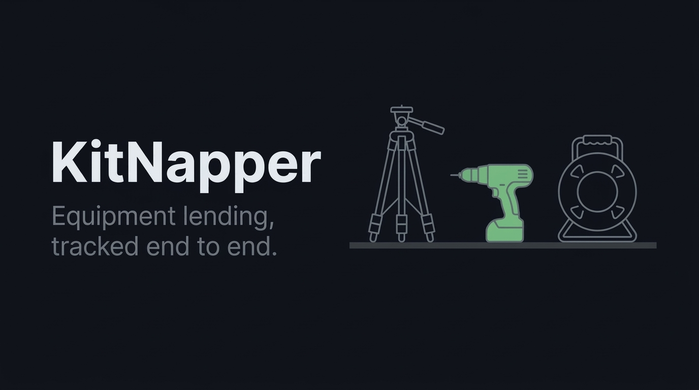

# KitNapper

<p align="center">
  
</p>

<p align="center">
  
  
  
  
</p>

A desktop application for managing equipment loans at a small institution. KitNapper replaces the paper sign-out sheet: staff publish available gear, students check items out, and the app tracks due dates, overdue loans, and late fees.

This repository currently contains the project documentation and a NetBeans Ant scaffold. The M0 domain core (`kitnapper.model`, 18 classes) is implemented and building; services, JSON persistence, and the Swing UI are not yet written.

## Contents

- [Requirements](#requirements)
- [Repository structure](#repository-structure)
- [Getting started](#getting-started)
- [Documentation](#documentation)
- [Project conventions](#project-conventions)
- [Status](#status)

## Requirements

- JDK 17 (developed against OpenJDK 17.0.20)
- NetBeans IDE with Ant project support

## Repository structure

```
Finals/
├── README.md
├── .editorconfig             shared formatting
├── .gitignore
├── assets/
│   └── banner.jpg            README banner image
├── docs/
│   ├── PRD.md                product requirements and domain model
│   ├── SRS.md                verifiable requirements and demo walkthrough
│   ├── design.md             Windows 11 / Fluent visual specification
│   ├── decisions.md          decision log
│   └── seed-data.md          seed data scope note
└── desktop-app/              NetBeans Ant project
    ├── build.xml
    ├── manifest.mf
    ├── nbproject/
    │   ├── project.xml
    │   ├── project.properties
    │   ├── build-impl.xml
    │   └── genfiles.properties
    ├── src/kitnapper/
    │   ├── Main.java         entry point (placeholder until M2)
    │   ├── model/            domain core — 18 classes (M0)
    │   ├── service/
    │   ├── view/
    │   └── controller/
    ├── test/
    └── resources/
        └── fonts/              bundled Inter (Regular, SemiBold, Bold)
```

`desktop-app/` is a separate project root because NetBeans identifies an Ant project by the presence of `nbproject/` next to `build.xml`. Keeping the Java project in its own directory allows the repository root to hold documentation and shared configuration without confusing the IDE.

On the NetBeans machine this repository lives at `OOP/Finals/`, so its paths carry `OOP/Finals/` prefixes (for example `OOP/Finals/desktop-app`). This checkout is the same tree with the repository root standing in for `Finals/` — `desktop-app/` here is `OOP/Finals/desktop-app` there, and `docs/` here is `Finals/docs/` in `docs/decisions.md`.

## Getting started

### NetBeans

1. Open NetBeans and choose **File > Open Project**.
2. Select `desktop-app/`, the directory containing `build.xml`.
3. Press **F6** to run or **F11** to build.

The main class is set to `kitnapper.Main` in `nbproject/project.properties`. `Main.java` is intentionally empty; the run target will fail until an entry point is added.

### Command line

The command-line Ant depends on the machine:

**NetBeans machine.** NetBeans bundles its own copy under `OOP/netbeans/extide/ant/bin/ant`:

```bash
cd OOP/Finals/desktop-app
../../netbeans/extide/ant/bin/ant clean jar
```

**Windows machine.** Apache Ant 1.10.18 is installed at `C:\Users\CIIT\tools\apache-ant-1.10.18` (on the user PATH, with `ANT_HOME` set). Repository checkout: `C:\Users\CIIT\Downloads\kitnapper`:

```bash
cd C:\Users\CIIT\Downloads\kitnapper\desktop-app
ant clean jar
```

Build output is written to `build/` and `dist/`, both of which are ignored by Git.

## Documentation

| Document | Description |
| :--- | :--- |
| [`docs/PRD.md`](docs/PRD.md) | Product scope, domain model, state transitions, seed data |
| [`docs/SRS.md`](docs/SRS.md) | Numbered requirements, invariants, acceptance criteria, demo script |
| [`docs/design.md`](docs/design.md) | Windows 11 / Fluent visual spec (v2.0): tokens, custom chrome, components, photo uploads; skeleton-loading plan pending in §13 |
| [`docs/decisions.md`](docs/decisions.md) | Record of confirmed decisions and known gaps |
| [`docs/implementation-plan.md`](docs/implementation-plan.md) | Build order, class/file inventory, JSON persistence spec, decisions D1–D23 |
| [`docs/seed-data.md`](docs/seed-data.md) | Where seed data lives and when to split it out |
| [`docs/logout-tokens.md`](docs/logout-tokens.md) | Runbook: logging out of every stored GitHub credential on the build machine |

The PRD and SRS are the sources of truth for behavior. If implementation and documentation disagree, the documentation takes precedence until both are updated together.

## Project conventions

- Java 17 and Swing. No JavaFX.
- NetBeans Ant build. No Maven or Gradle.
- No third-party libraries; JSON persistence and the Swing theme are written against the JDK only.
- MVC layering: `model`, `service`, `controller`, `view`.
- Source files stay under 200 lines, with 100 to 150 as the target.
- Currency is the Philippine peso, formatted as `₱1,234.00`.
- Dates use `java.time.LocalDate`.

## Status

Documentation complete, M0 domain core implemented (18 model classes, invariant-enforced). Services, JSON persistence, and the Swing UI are next (M1–M6). See `docs/decisions.md` for the decision record, `docs/implementation-plan.md` for the build order, and `docs/design.md` §13 for the open skeleton-loading plan.
