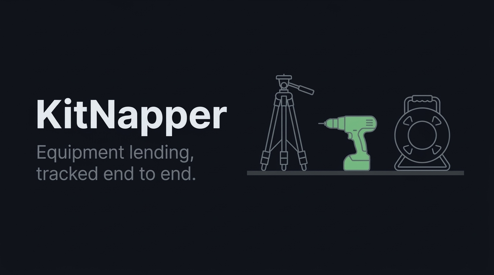

# KitNapper

<p align="center">
  
</p>

<p align="center">
  
  
  
  
</p>

A desktop application for managing equipment loans at a small institution. KitNapper replaces the paper sign-out sheet: staff publish available gear, students check items out, and the app tracks due dates, overdue loans, and late fees.

The domain core, the hand-written JSON persistence layer, the Windows 11 application shell with mock login, the catalog with instant checkout, the loan/penalty manager views, the inventory screens with photo uploads and demo reset, and the M6 polish pass (thin scrollbars, Fluent motion fades, minimum-size fixes, icon/DPI/skeleton audits) are implemented, building, and covered by an in-repository probe suite. M6's interactive walkthrough remains before close-out.

## Contents

- [Requirements](#requirements)
- [Repository structure](#repository-structure)
- [Getting started](#getting-started)
- [Documentation](#documentation)
- [Project conventions](#project-conventions)
- [Status](#status)

## Requirements

- JDK 17 (developed against OpenJDK 17.0.20)
- NetBeans IDE with Ant project support

## Repository structure

```
Finals/                       (the repository root)
├── README.md
├── HANDOFF-M1.md             working docs for finished milestones
├── HANDOFF-M2.md
├── HANDOFF-M3.md
├── HANDOFF-M3-PLAN.md        M3 record: plan and execution log
├── HANDOFF-M4.md             M4 scope note (historical at close-out)
├── HANDOFF-M4-PLAN.md        M4 record: plan and execution log
├── HANDOFF-M5.md             M5 scope note (historical at close-out)
├── HANDOFF-M5-PLAN.md        M5 record: plan and execution log
├── HANDOFF-M6-PLAN.md        M6 record: plan and execution log (WP0–WP4)
├── HANDOFF-SESSION-2026-11-14.md
├── .editorconfig             shared formatting
├── .gitattributes            LF everywhere; binary assets not normalized
├── .gitignore
├── assets/
│   └── banner.jpg            README banner image
├── docs/
│   ├── PRD.md                product requirements and domain model
│   ├── SRS.md                verifiable requirements and demo walkthrough
│   ├── design.md             Windows 11 / Fluent visual specification
│   ├── decisions.md          decision log
│   ├── implementation-plan.md  class inventory, JSON schema, milestones M0–M6
│   ├── preferences.md        tracked working preferences
│   └── seed-data.md          seed data scope note
└── desktop-app/              NetBeans Ant project
    ├── build.sh              JDK-only clean/build/run helper (no Ant needed)
    ├── build.xml
    ├── manifest.mf
    ├── nbproject/
    │   ├── project.xml
    │   ├── project.properties
    │   ├── build-impl.xml
    │   └── genfiles.properties
    ├── src/kitnapper/
    │   ├── Main.java         entry point — installs theme/fonts, shows LoginFrame
    │   ├── model/            domain core — 18 classes (M0)
    │   ├── service/          services, AppContext, ID/seed helpers (M1–M5)
    │   │   └── persistence/  hand-written JSON parser, writer, mappers (M1)
    │   ├── controller/       AppController, ScreenMounts, and the per-screen actions (14 classes)
    │   └── view/             theme, chrome, shell, screens, previews, dialogs, motion (89 classes)
    ├── test/                 probe harness: 20 probes + run-all.sh (xvfb-aware)
    └── resources/
        └── fonts/              bundled Inter (Regular, SemiBold, Bold)
```

`desktop-app/` is a separate project root because NetBeans identifies an Ant project by the presence of `nbproject/` next to `build.xml`. Keeping the Java project in its own directory allows the repository root to hold documentation and shared configuration without confusing the IDE.

This repository is checked out under `OOP/Finals/` in the course tree. Some handoff docs were written on machines where the repository root was a bare `kitnapper/` folder (or a NetBeans project at `OOP/Finals/`), so they carry machine-specific path prefixes; treat those as history and use paths relative to this repository root.

## Getting started

### NetBeans

1. Open NetBeans and choose **File > Open Project**.
2. Select `desktop-app/`, the directory containing `build.xml`.
3. Press **F6** to run or **F11** to build.

The main class is set to `kitnapper.Main` in `nbproject/project.properties`. It installs the theme and bundled fonts, builds `AppContext`, and shows `LoginFrame` on the EDT.

### Command line

Apache Ant is not installed on every machine, so use whichever of these is available:

```bash
# Ant on the PATH
cd desktop-app
ant clean jar
ant run

# Ant bundled with NetBeans (adjust the path to your install)
cd desktop-app
../../netbeans/extide/ant/bin/ant clean jar

# No Ant at all — the helper script (JDK only)
cd desktop-app
./build.sh build      # clean | build | run
./build.sh run

# ...or plain javac by hand
cd desktop-app
mkdir -p build/classes
find src -name '*.java' > /tmp/kn-sources.txt
javac -encoding UTF-8 -d build/classes @/tmp/kn-sources.txt
java -cp build/classes kitnapper.Main
```

Build output is written to `build/` and `dist/`, both of which are ignored by Git. The runtime save file (`kitnapper-data.json`) and photo folder (`kitnapper-images/`) are created in the working directory and are ignored too.

## Documentation

| Document | Description |
| :--- | :--- |
| [`docs/PRD.md`](docs/PRD.md) | Product scope, domain model, state transitions, seed data |
| [`docs/SRS.md`](docs/SRS.md) | Numbered requirements, invariants, acceptance criteria, demo script |
| [`docs/design.md`](docs/design.md) | Windows 11 / Fluent visual spec (v2.0): tokens, custom chrome, components, photo uploads, skeleton loading states (§13) |
| [`docs/decisions.md`](docs/decisions.md) | Record of confirmed decisions and known gaps |
| [`docs/implementation-plan.md`](docs/implementation-plan.md) | Build order, class/file inventory, JSON persistence spec, decisions D1–D43 |
| [`docs/seed-data.md`](docs/seed-data.md) | Where seed data lives and when to split it out |
| [`docs/preferences.md`](docs/preferences.md) | Tracked, machine-independent working preferences: planning, one-phase execution, document-commit-push, verification |
| [`HANDOFF-M4.md`](HANDOFF-M4.md) | M4 scope note: current state, reuse map, gotchas, probe commands (historical at M4 close-out; the contract was `HANDOFF-M4-PLAN.md`) |
| [`HANDOFF-M4-PLAN.md`](HANDOFF-M4-PLAN.md) | M4 record: plan, work packages, probe plan, execution log, width pass |
| [`HANDOFF-M5.md`](HANDOFF-M5.md) | M5 scope note: inventory, photos, reset (historical at M5 close-out; the contract was `HANDOFF-M5-PLAN.md`) |
| [`HANDOFF-M5-PLAN.md`](HANDOFF-M5-PLAN.md) | M5 record: plan, work packages, probe plan, execution log, deviations |
| [`HANDOFF-M6-PLAN.md`](HANDOFF-M6-PLAN.md) | **M6 record:** plan, work packages (WP0–WP4 shipped), probe plan, execution log |
| [`HANDOFF-M3-PLAN.md`](HANDOFF-M3-PLAN.md) | M3 record: plan, work packages, probe plan, execution log |
| [`HANDOFF-M3.md`](HANDOFF-M3.md), [`HANDOFF-M2.md`](HANDOFF-M2.md), [`HANDOFF-M1.md`](HANDOFF-M1.md), [`HANDOFF-SESSION-2026-11-14.md`](HANDOFF-SESSION-2026-11-14.md) | Historical records of finished milestones (machine-specific paths and probe commands are stale) |

The PRD and SRS are the sources of truth for behavior. If implementation and documentation disagree, the documentation takes precedence until both are updated together.

## Project conventions

- Java 17 and Swing. No JavaFX.
- NetBeans Ant build. No Maven or Gradle.
- No third-party libraries; JSON persistence and the Swing theme are written against the JDK only.
- MVC layering: `model`, `service`, `controller`, `view`.
- Source files stay under 200 lines, with 100 to 150 as the target.
- Currency is the Philippine peso, formatted as `₱1,234.00`.
- Dates use `java.time.LocalDate`.

## Status

Documentation complete; M0 (domain core), M1 (JSON persistence), M2 (Win11 shell + mock login), **M3 (catalog + instant checkout)**, **M4 (returns, fees, manager views)**, **M5 (inventory, photos, reset, settings)** and **M6 (polish)** are implemented and probed on JDK 17. M6's interactive SRS §6.2 walkthrough is the one remaining step before close-out.

M3 ships the real Catalog screen: search plus category/status filters, a details table with a 280 px preview pane, a cards view with shared selection, an empty state, and a 480 px checkout dialog whose due date is a `T … T+14` picker. Checkout persists, locks the item, and keeps validation errors inline. Managers get the same catalog read-only — no checkout action, an explicit caption instead.

M5 ships the manager's inventory: an items table with the omnibar text filter and a photo preview, an add/edit dialog whose extra field follows the item's concrete kind, and per-item photo import that validates, downscales to 1024 px, re-encodes JPEG q0.85, and stores `kitnapper-images/<equipmentId>.jpg` atomically. Photos render through a shared tile with the app's first loading skeletons (150 ms delay, 300 ms minimum, 167 ms fade, 10 s watchdog), falling back to the category tile when a file is missing or corrupt. Maintenance and decommission are refused while the item is still out, and Settings carries the theme switch, the "Animate loading placeholders" switch, the save-file and photo-folder locations, and a confirmed demo reset that empties the photo folder and restores the seed relative to today.

M6 is polish, not features: thin overlay-style scrollbars on every scroll surface, the dialog and screen fades behind a `-Dkitnapper.motion=off` probe switch (the theme switch stays instant), one width policy that makes all four tables scroll at their preferred widths instead of clipping badges, compact preview density plus a metadata scroll guard so the 1024×640 minimum keeps every row and the pinned action, preview-aware toasts, and the icon/DPI/skeleton audits. The audits closed D32 by measurement — the slowest of eight catalog/loan/dashboard queries is 0.46 ms against the 150 ms gating threshold, so no query gets a skeleton — and fixed a real rendering defect: fallback glyphs were being drawn with the physical Inter font, which lacks them, so on Linux the title-bar brand, window controls and every category tile rendered as missing-glyph boxes. `Fonts.symbol()` now resolves them through the logical `Dialog` font.

Verification lives **inside** the repository: `desktop-app/test/run-all.sh` builds the app and runs twenty probes (`DataProbe`, `CatalogProbe`, `LoanProbe`, `InventoryProbe`, `SkinProbe`, `FontProbe`, `EdgeProbe`, `SizeProbe`, `FrameProbe`, `CloseProbe`, `CatalogUiProbe`, `PhotoUiProbe`, `InventoryEditorProbe`, `InventoryUiProbe`, `SettingsUiProbe`, `M5FlowProbe`, `LoansLayoutProbe`, `LoansUiProbe`, `GeometryProbe`, `MotionProbe`), using `xvfb-run -a` for the paint probes so they work with or without a display. `KITNAPPER_UI_SCALE=1.25` (or `1.5`) runs the same suite at a DPI proxy. It is the gate for every remaining work package, together with the SRS §6.2 walkthrough.

Next: M6 WP5 — the interactive SRS §6.2 pass on a real display (1920×1080, 1366×768, 1024×640 and the Windows 100/125/150 % scaling matrix), then close-out docs and the presentation deck. See `docs/decisions.md` for the decision record, `docs/implementation-plan.md` for the build order, and `HANDOFF-M6-PLAN.md` for the M6 record.
